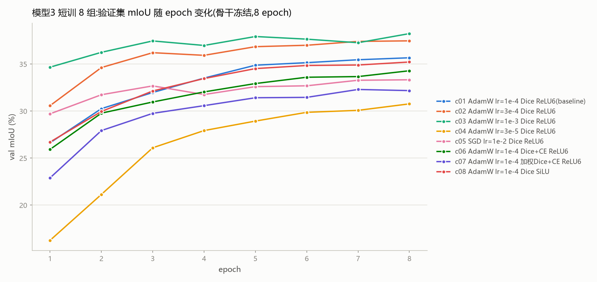
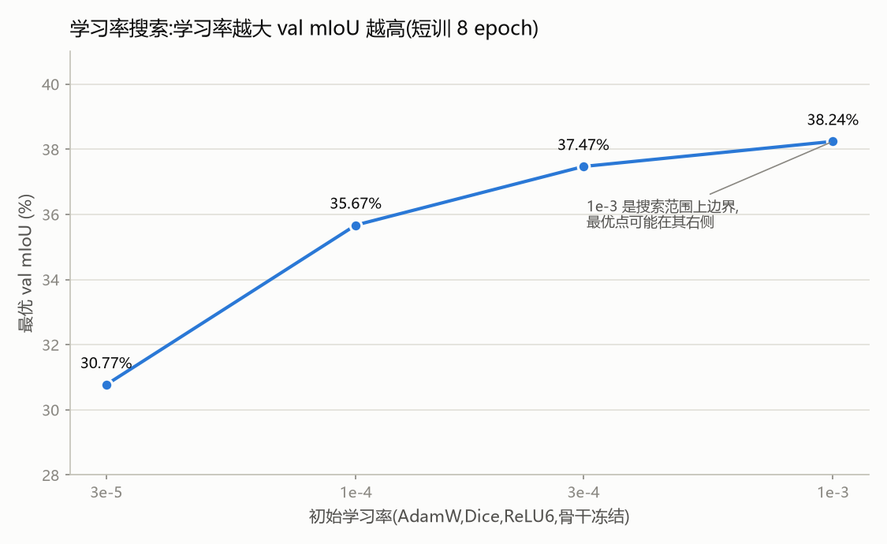
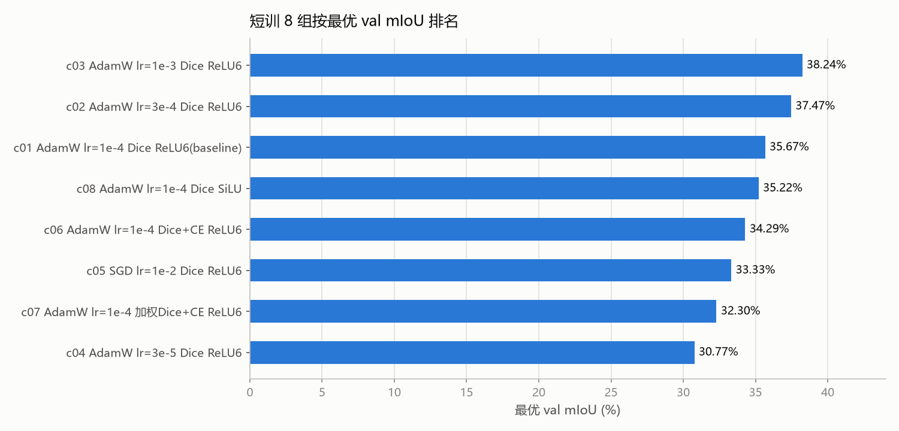
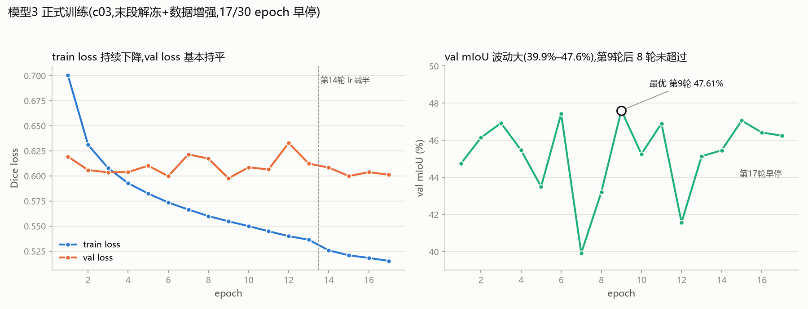
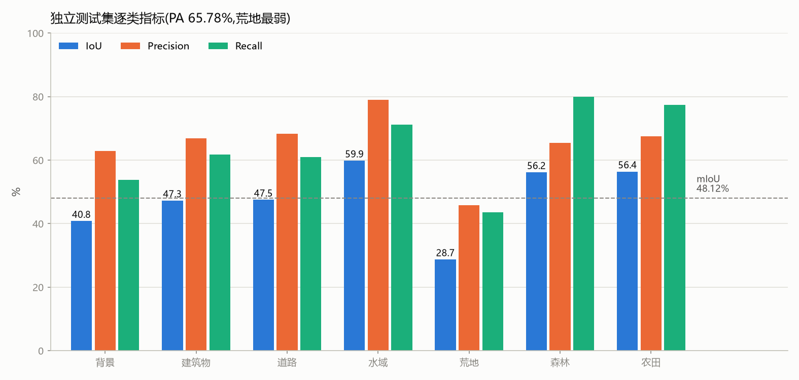

# 模型 3 MobileNetV3-SFPN 实验报告(成员 E)

> 数据均来自本机 CPU 实测,可由 `C:\zz\model3_results\` 下的文件复现。所有"估计""推断"均已标明,未标明的数字都是实测值。

## 0 摘要

| 项目 | 结果 |
|---|---|
| 任务 | 512×512 遥感影像 7 类像素级语义分割,标签 0(无数据)忽略 |
| 数据划分 | LoveDA 带标签 4191 张,重新划分为 train 2519 / val 837 / test 835,互斥,测试集全程不参与训练与调参 |
| 短训调参 | 8 组(骨干全冻结,8 epoch),val mIoU 最优为 c03(AdamW,lr=1e-3,Dice,ReLU6)38.24% |
| 正式训练 | c03 配置 + 末段解冻 + 数据增强,17/30 epoch 早停,最优第 9 轮 val mIoU **47.61%**,PA 65.25% |
| **独立测试集** | **mIoU 48.12%,PA 65.78%**(无 TTA) |
| 最弱类别 | 荒地(IoU 28.75%) |
| 训练时长 | 正式训练单跑 17 个 epoch,共 49,510 秒(13.75 小时),每个 epoch 约 43 到 50 分钟 |
| 模型规模 | 3,141,143 参数,权重文件 12.6MB(`m3_formal_c03_best.pth`) |

## 1 数据集与协议

- 数据:LoveDA(南京、常州、武汉,0.3m,城市+乡村)。官方带标签样本 4191 张,由成员 B 重新划分并锁定,见 `DATASET_REPORT.md`。
- 划分:train 2519 / val 837 / test 835。压缩包里每个目录多出的 1 个条目是目录本身,不是图片。
- 类别与 train 集像素占比:背景 32.16%、建筑物 9.22%、道路 5.35%、水域 8.85%、荒地 4.74%、森林 15.42%、农田 24.26%(占比以有效像素为分母,不含无数据)。val 和 test 的占比与 train 最大相差 0.43 个百分点。
- 统一协议:输入 512×512,batch size 1,seed 42,ImageNet 预训练,超参筛选依据 val mIoU,评测忽略标签 0。
- 评测指标:PA、mIoU、逐类 IoU、Precision、Recall、Dice,由混淆矩阵计算(`metrics.py`)。

## 2 网络结构

### 2.1 整体

`MobileNetV3-Large 骨干(取 3 个尺度)→ FPN 融合 → 移动端 Decoder → 7 通道输出`。

| 部分 | 内容 | 参数量 |
|---|---|---:|
| layer1 | 首层 3×3 卷积 stride 2(3→16),再接 InvertedResidual 块,输出 24 通道,stride 4 | 9,544 |
| layer2 | 3 个 InvertedResidual 块(5×5 深度卷积 + SE),输出 40 通道,stride 8 | 53,800 |
| layer3 | 9 个 InvertedResidual 块 + 1×1 `lastconv`(160→960),输出 960 通道,stride 32 | 2,933,008 |
| FPN | 3 个 1×1 卷积:24→128、40→128、960→128;自顶向下,最近邻上采样后逐元素相加,输出 128 通道,stride 4 | 131,456 |
| Decoder | 深度可分离卷积 128→64,双线性上采样 ×2,深度可分离 64→32、32→16,1×1 卷积 16→7,再双线性上采样回 512×512 | 13,335 |
| 合计 | | 3,141,143 |

数据来自 `introspect_model.py` 的实测统计(`model3_results/work/model3_layers.txt`)。

### 2.2 逐项说明(对应计划第十节第 1 点)

- **卷积层:共 72 个。** 骨干含大量 1×1 扩展/压缩卷积和深度卷积(核 3×3 或 5×5),另有 SE 模块里的 1×1 卷积。逐层的滤波器个数、滤波器深度、核大小、步长和激活函数见本文**附录 A**(72 行明细表)。
- **池化层:没有最大池化。** 骨干里有 8 个全局平均池化,位于 SE(通道注意力)模块内部,不用于降采样。下采样由 5 个 stride 为 2 的卷积完成,总步长 32。
- **全连接层:0 个。** SE 模块里的"全连接"用 1×1 卷积实现。
- **激活函数:** 骨干为 Hardswish(20 处)、ReLU(19 处)、SE 门控 Hardsigmoid(8 处);Decoder 使用 ReLU6(3 处),短训第 8 组换成 SiLU 做对比。
- **输出层:** 1×1 卷积,16→7,即每个像素 7 个神经元,对应 7 个类别。模型本身不带 softmax,softmax 在损失函数和评测的 argmax 里处理。

### 2.3 冻结情况与一个需要如实说明的问题

| 阶段 | 可训练参数 | 说明 |
|---|---:|---|
| 短训 | 13,111 | 只有 Decoder 在训练,骨干和 FPN 全部冻结 |
| 正式训练 | 2,946,119 | layer3(2,933,008)与 Decoder(13,111)在训练 |

**FPN 的 3 个 1×1 卷积(131,456 参数)在所有实验里始终冻结,而且是随机初始化,从未被训练。** 原因是它们定义在 `backbone` 内部,`freeze_layer` 冻结了整个 `backbone`,"末段解冻"只放开了 `layer3`。我用代码实测确认:短训和正式训练里 FPN 的可训练参数都是 0。模型 1 的 FPN 同样定义在冻结的骨干里,结构相同,所以此问题大概率同样存在,但我没有跑模型 1。

影响:Decoder 是在"预训练骨干特征经随机固定投影"之上学习的,这很可能限制了精度上限。我没有实验证明具体影响有多大,这属于后续可以尝试的改进,不在本次实验范围内,也没有改动代码。

### 2.4 选择该结构的理由(第十部分 1(2))

- 计划指定模型 3 为经典轻量网络 MobileNetV3,与模型 1(ResNet50-SFPN)、模型 2(VGG16-UNet)在同一数据划分、同一输入、同一评测协议下横向对比。
- MobileNetV3-Large 只有约 3.1M 参数,骨干用深度可分离卷积、SE 注意力和 Hardswish,是面向移动端设计的轻量网络,代表"小模型"这一端,和参数量大得多的 ResNet50、VGG16 形成对照。
- 使用 paddle.vision 提供的 ImageNet 预训练权重,与另外两个模型的预训练来源一致。
- FPN 融合加移动端 Decoder 与模型 1 同款,这样模型 1 与模型 3 的差别主要在骨干上。

### 2.5 本次尝试的网络的优缺点(第十部分 1(3),只写模型 3)

> 说明:第十部分要求说明"尝试的网络模型"的优缺点。我只负责模型 3,所以这一节只写 MobileNetV3-SFPN(含我试过的两种训练方式:骨干全冻结的短训、末段解冻的正式训练)。模型 1、模型 2 的优缺点,以及三模型之间的对比,等 C、D 的结果到齐后由汇总者补充。下面的数字都是本机实测,"推测"的地方已标明。

**优点**

| 方面 | 实测依据 |
|---|---|
| 模型小 | 总参数 3,141,143;权重文件约 12.6MB(`m3_formal_c03_best.pth`),便于保存、传输和部署 |
| 训练占用资源少 | 每个训练进程约 0.75GB 内存;短训只有 13,111 个可训练参数,在 8 个进程并行时没有出现显存或内存不足 |
| 推理开销低 | 测试集 835 张整体评测约 4 分 7 秒(单进程 CPU,约 0.3 秒/张) |
| 大面积、纹理稳定的类别表现较好 | 测试集上水域 IoU 59.86%(Precision 78.97%),森林 56.19%,农田 56.42%,Recall 分别为 71.21%、79.98%、77.36% |
| 解冻与增强带来明显提升 | 同一超参下,短训(骨干冻结)val mIoU 38.24%,正式训练(layer3 解冻 + 数据增强)47.61%,约提升 9.4 个百分点 |

**缺点**

| 方面 | 实测依据或推测 |
|---|---|
| 整体精度不高 | 测试集 mIoU 48.12%,PA 65.78% |
| 小类别和易混类别差 | 荒地 IoU 仅 28.75%:30.5% 的荒地像素被预测成农田,19.7% 被预测成背景;背景 IoU 40.83% |
| 容易过拟合 | 正式训练 train loss 从 0.700 降到 0.515,val loss 始终在 0.60 附近不再下降,第 9 轮后 8 轮没有超过最优,触发早停 |
| 验证指标不稳定 | 17 个 epoch 里 val mIoU 在 39.92% 到 47.61% 之间波动,相邻轮差 3 到 7 个百分点。原因是推测:batch size 为 1,梯度噪声大,加上解冻的 layer3 里 BN 统计量不断更新 |
| CPU 上训练并不快 | 骨干冻结时单步约 0.58 秒;解冻加增强后单步约 1.25 秒,每个 epoch 约 43 到 50 分钟。单步前向约 650 毫秒、反向约 576 毫秒(其中骨干前向 490 毫秒,8 组并行干扰下的测量值)。原因是推测:Paddle 在 CPU 上对深度卷积等算子的实现不高效,且单个进程只用 1 个线程 |
| FPN 的 1×1 卷积没有被训练 | 3 个 1×1 卷积(131,456 参数)在所有实验里冻结在随机初始化(见 2.3),很可能限制精度上限,但影响多大没有实验证明 |
| 对学习率敏感 | 短训里 lr 从 3e-5 到 1e-3,val mIoU 从 30.77% 一路升到 38.24%,最优点没有框住 |

**小结:** MobileNetV3-SFPN 的主要优势是小而轻,适合部署;代价是精度有限,尤其是荒地这类小类别,同时在 CPU 上训练和推理并不像参数量暗示的那么快。这些判断只来自模型 3 自身的实验,与模型 1、2 的比较尚未开始。

## 3 损失函数与学习率

### 3.1 损失函数

- **Dice 损失**(`losses.py`):对 softmax 输出,逐类计算后取平均,忽略标签 0。

  `L_dice = (1/C') Σ_c [ 1 − (2 Σ p_c·g_c + ε) / (Σ p_c + Σ g_c + ε) ]`,ε = 1e-5,C' 是参与平均的类别数。代码对 `union > ε` 的类别求平均,而 softmax 概率恒为正,所以实际是 7 个类别全部参与。
- **Dice+CE:** `L = L_dice + L_CE`,交叉熵忽略标签 0。
- **加权 Dice+CE:** 交叉熵带类别权重 `0.2869 1.0000 1.7235 1.0425 1.9462 0.5980 0.3803`(来自 `class_weights.txt`,荒地占比低于 5%,权重较大)。
- 选用 Dice 的理由:分割任务的评测指标 mIoU 与 Dice 相关性高,且 Dice 对类别不平衡不敏感。交叉熵提供逐像素的稳定梯度。
- **反向传播如何作用到权重:** 前向得到 7 通道输出 `y` 与损失 `L`。反向时从损失出发,按链式法则逐层求梯度:`∂L/∂W = ∂L/∂y · ∂y/∂W`。梯度依次经过 softmax、输出 1×1 卷积、Decoder 的 3 个深度可分离卷积,短训到此为止(只有 Decoder 的 13,111 个参数可训练);正式训练里梯度继续经 FPN 的固定投影回传到 `layer3`,更新 layer3 的 2,933,008 个参数。`stop_gradient=True` 的参数(骨干前两段和 FPN)不接收更新。回传得到的梯度先做全局范数裁剪(`‖g‖ ≤ 1.0`),再由优化器按各自规则更新权重 `W ← W − Δ`。
- **尝试了 3 种损失:** Dice、Dice+CE、加权 Dice+CE。

### 3.2 学习率

- 短训搜索了 4 个初始学习率(AdamW、Dice、ReLU6):3e-5、1e-4、3e-4、1e-3,另有 SGD 的 1e-2。短训 lr 恒定(`--no-scheduler`),比较的就是初始学习率。
- 最终采用:**解码器 lr = 1e-3,layer3 骨干 lr = 1e-4**(协议:骨干 lr = 基础 lr × 0.1)。
- 正式训练调度器为 ReduceOnPlateau(patience 3,factor 0.5),在第 14 轮把 lr 从 1e-3 降到 5e-4,之后未再变化。

## 4 优化器

- **AdamW:** 对每个参数维护梯度的一阶动量 `m` 和二阶动量 `v`,按各自的历史梯度大小自适应调整步长,权重衰减与梯度更新解耦:

  `m_t = β1·m_{t−1} + (1−β1)·g_t`,`v_t = β2·v_{t−1} + (1−β2)·g_t²`

  `θ_t = θ_{t−1} − lr · ( m̂_t / (√v̂_t + ε) + λ·θ_{t−1} )`,其中 `m̂`、`v̂` 为偏差修正后的值。

  本实验 λ(weight_decay)= 1e-5,β1、β2、ε 取 Paddle 的默认值(0.9、0.999、1e-8)。特点是收敛快、对学习率不太敏感,适合 batch size 为 1、梯度噪声大的情形,是本实验的主力优化器。
- **SGD(带动量 0.9,weight_decay 1e-4):** `v_t = μ·v_{t−1} + g_t`,`θ_t = θ_{t−1} − lr · v_t`,μ = 0.9。所有参数共用同一个学习率,对学习率的选择更敏感,收敛通常更慢。选它是作为与 AdamW 对比的另一类优化器。
- 梯度统一做全局范数裁剪(clip_norm = 1.0)。
- **尝试了 2 种优化器:** AdamW、SGD(带动量)。
- 注意:`train.py` 的 SGD 分支调用 `paddle.optimizer.SGD(momentum=0.9)`,该参数 Paddle 的 SGD 不支持,会直接报错。我在自己的包装器里改为 `paddle.optimizer.Momentum`(动量 0.9、权重衰减 1e-4、梯度裁剪不变),未改动共用的 `train.py`。

## 5 实验结果与分析

### 5.1 短训 8 组(骨干全冻结,8 epoch)

| 排名 | 实验 | 配置 | 最优 epoch | val mIoU | val PA |
|---:|---|---|---:|---:|---:|
| 1 | c03 | AdamW lr=1e-3 Dice ReLU6 | 8 | 38.24% | 55.90% |
| 2 | c02 | AdamW lr=3e-4 Dice ReLU6 | 8 | 37.47% | 55.24% |
| 3 | c01 | AdamW lr=1e-4 Dice ReLU6(baseline) | 8 | 35.67% | 53.91% |
| 4 | c08 | AdamW lr=1e-4 Dice **SiLU** | 8 | 35.22% | 53.45% |
| 5 | c06 | AdamW lr=1e-4 **Dice+CE** ReLU6 | 8 | 34.29% | 55.36% |
| 6 | c05 | **SGD** lr=1e-2 Dice ReLU6 | 8 | 33.33% | 54.00% |
| 7 | c07 | AdamW lr=1e-4 **加权 Dice+CE** ReLU6 | 7 | 32.30% | 49.05% |
| 8 | c04 | AdamW lr=3e-5 Dice ReLU6 | 8 | 30.77% | 51.63% |







**现象与解释**

1. **学习率越大越好,最优点没有框住。** 3e-5、1e-4、3e-4、1e-3 对应 30.77%、35.67%、37.47%、38.24%,单调上升。1e-3 是试过的最大值,最优可能更大。短训的 8 个 epoch 里,小学习率收敛慢,3e-5 的曲线在第 8 轮仍在上升,说明它不是"差",是"还没学够"。
2. **c03 与 c02 只差 0.77 个百分点。** c03 自己在第 5 到 8 轮的 mIoU 在 37.3% 到 38.2% 之间波动,单个随机种子的结果不足以说 c03 一定优于 c02。
3. **Dice+CE 和加权 Dice+CE 的 loss 数值是 2 到 3,Dice 是 0.6 到 0.9。** 这是因为 `L = L_dice + L_CE`,交叉熵项在 7 类、初期约为 ln 7 ≈ 1.95。两者的 loss 值不能直接比较,只能比 mIoU。
4. **加权 Dice+CE 的 PA 明显更低**(49% vs 54%),mIoU 也更低(32.30% vs 35.67%)。可能的原因是类别权重改变了各类的损失占比(推测,没有逐类分析验证)。该结论只在 lr=1e-4 下得到,没有在最优学习率下重做。
5. **SiLU 比 ReLU6 低 0.45 个百分点,在波动范围内,不能说两者有差别。** SGD(1e-2)低于同条件 AdamW 约 2.3 个百分点。
6. 多数曲线到第 8 轮仍在上升,说明 8 个 epoch 的短训没有完全收敛,筛选出的是"8 个 epoch 内学得最快"的配置。

### 5.2 正式训练(c03 + 末段解冻 + 数据增强)

| 项目 | 值 |
|---|---|
| 配置 | AdamW,解码器 lr=1e-3,layer3 lr=1e-4,Dice,ReLU6,数据增强(翻转、90° 旋转、亮度对比度抖动),调度器 ReduceOnPlateau |
| 训练轮数 | 17/30,第 17 轮早停(val mIoU 连续 8 轮没有超过第 9 轮) |
| 最优轮 | 第 9 轮:val mIoU 47.61%,val PA 65.25%,val loss 0.5976 |
| 训练时长 | 49,510 秒 = 13.75 小时(单跑),单个 epoch 2557 到 2982 秒 |



**现象与解释**

1. **解冻 layer3 并加数据增强后,val mIoU 从 38.24% 提升到 47.61%,约 +9.4 个百分点。** 但解冻、增强是同时改的,训练轮数也不同(8 对 17),无法拆分各自的贡献。
2. **val mIoU 波动很大。** 17 轮里最低 39.92%(第 7 轮),最高 47.61%(第 9 轮),相邻轮之间能差 3 到 7 个百分点。val loss 却基本平稳(0.598 到 0.633)。我的判断(未验证):batch size 为 1,梯度噪声大,而且 layer3 的 BN 统计量在训练中不断更新,导致验证表现跳动。最优轮是在这些波动里选出的最高点。
3. **过拟合迹象:** train loss 从 0.700 一路降到 0.515,val loss 在 0.60 附近不再下降,说明 layer3 解冻后训练集上继续拟合,验证集上不再受益。
4. 第 14 轮 lr 减半后,train loss 有一个小台阶,val 指标没有明显改善。

### 5.3 独立测试集(835 张,无 TTA)

| 类别 | IoU | Precision | Recall | Dice |
|---|---:|---:|---:|---:|
| 背景 | 40.83% | 62.89% | 53.79% | 57.99% |
| 建筑物 | 47.29% | 66.83% | 61.80% | 64.22% |
| 道路 | 47.53% | 68.23% | 61.04% | 64.44% |
| 水域 | 59.86% | 78.97% | 71.21% | 74.89% |
| 荒地 | 28.75% | 45.81% | 43.56% | 44.65% |
| 森林 | 56.19% | 65.39% | 79.98% | 71.95% |
| 农田 | 56.42% | 67.58% | 77.36% | 72.14% |
| **整体** | **mIoU 48.12%** | | | **PA 65.78%** |



验证集上用同一份并行评测脚本复核,得到 mIoU 47.61%、PA 65.25%,与训练日志第 9 轮完全一致。

**分析(基于混淆矩阵 `m3_formal_c03_test_eval_confusion.csv`)**

- 测试集 mIoU(48.12%)比验证集(47.61%)略高 0.5 个百分点。验证集的最优值是在多个 epoch 里挑出来的最高点,所以偏乐观,测试集没有被选择过。这个差距在波动范围内,不能解读为模型泛化得更好。
- **荒地最弱。** 荒地真实像素中,30.5% 被预测成农田,19.7% 被预测成背景;只有 43.6% 预测正确。荒地在训练集里仅占 4.74%,样本少,外观又与农田、裸露背景接近。
- **背景类 IoU 也低(40.8%)。** 背景是"其他"的杂类,14.9% 被预测成农田,12.4% 被预测成森林。另外建筑物有 26.2% 被预测成背景。
- **森林和农田召回高(约 80%、77%),精度较低(约 65%、68%)。** 模型倾向于把不确定的区域预测成这两个大类。

### 5.4 速度现象(CPU 训练)

- 单个训练进程只占满 1 个逻辑核(约 6% 的总 CPU),其余 15 个逻辑线程空闲。`FLAGS_use_mkldnn` 为 False,Paddle 没有启用 oneDNN。这是推断,没有做开启后的对比实验。
- 单步耗时拆分(8 组并行干扰下实测):读图 27 毫秒(2%)、前向 650 毫秒(48%,其中骨干 490 毫秒)、损失 86 毫秒、反向 576 毫秒(43%)、优化器更新 2 毫秒。
- 8 组并行时每步 1.16 秒,单跑 0.58 秒,总吞吐是单跑的约 4 倍。
- 因此短训每组约 8 小时的用时(485 到 503 分钟)是 8 组并行下的数,正式训练的 13.75 小时是单跑,两者不可直接比较。

## 6 局限与建议

1. 每个配置只跑了 1 个随机种子,配置之间小于约 1 个百分点的差异不能当作真实差异。
2. 学习率搜索的上边界没有框住,1e-3 之外的值没有试过。
3. FPN 的 1×1 卷积始终冻结在随机初始化(见 2.3),可能限制精度,建议与组员商量是否需要在后续让它可训练,协议规定结构冻结,改动需要补做学习率复核。
4. 正式训练的最优轮是在波动的验证曲线上挑的最高点,val mIoU 偏乐观,报告里以测试集 48.12% 为准。
5. 解冻与数据增强同时引入,无法给出各自贡献,如需要要补一组只开其中一项的对照实验。
6. 评测未用 TTA。`eval.py` 支持 `--tta`,约 4 倍耗时,三个模型要用同样的评测方式才可比。

## 7 文件索引

| 内容 | 路径 |
|---|---|
| 汇总表(含 8 组短训、逐轮、正式训练、测试集、图表) | `C:\zz\model3_results\model3_tuning_summary.xlsx` |
| 逐轮明细、汇总 CSV | `model3_epochs_all.csv`、`model3_tuning_summary.csv` |
| 图表 | `C:\zz\model3_results\figures\fig1` 到 `fig5` |
| 测试集结果与混淆矩阵 | `eval_test\m3_formal_c03_test_eval.csv`、`..._confusion.csv` |
| 原始训练日志 | `raw_logs\` |
| 网络层结构导出 | `work\model3_layers.txt` |
| 共用调参表(已填 M3-01 到 M3-08) | `C:\zz\人工智能小组\tuning_log.xlsx`(原版备份:`model3_results\backup\`) |
| 正式训练最优权重 | `C:\zz\runs_local\m3_formal_c03_best.pth` |
| 短训各组权重与日志 | `C:\zz\runs_local\m3_c01` 到 `m3_c08` |
| 进度页面与脚本 | `C:\zz\progress_ui\` |

## 8 复现命令(本机,venv 为 `C:\zz\venv_paddle`)

```
# 正式训练
python run_with_progress.py --train-img <train/images_png> --train-mask <train/masks_png> \
  --val-img <val/images_png> --val-mask <val/masks_png> --backbone mobilenet_v3 \
  --unfreeze-last-stage --augment --epochs 30 --patience 8 --seed 42 \
  --lr 1e-3 --optimizer adamw --loss dice --activation relu6 --run-name m3_formal_c03

# 测试集评测(项目自带)
python eval.py --checkpoint m3_formal_c03_best.pth --test-img <test/images_png> --test-mask <test/masks_png>
```

`run_with_progress.py` 是对 `train.py` 的包装,逻辑等价,只多写进度文件。

---

## 附录 A 模型3 逐层卷积明细(共 72 个卷积层)

滤波器个数 = 输出通道数;滤波器深度 = 输入通道数 ÷ groups(深度卷积为 1)。激活函数列里 `BN→X` 表示该卷积后接批归一化再接激活 X。

| # | 层名 | 类型 | 滤波器个数 | 滤波器深度 | 核 | 步长 | 后接 |
|---:|---|---|---:|---:|---|---:|---|
| 1 | `backbone.layer1.0.0` | 标准卷积 | 16 | 3 | 3×3 | 2 | BN→Hardswish |
| 2 | `backbone.layer1.1.0.bottleneck_conv.0` | 深度卷积 | 16 | 1 | 3×3 | 1 | BN→ReLU |
| 3 | `backbone.layer1.1.0.linear_conv.0` | 逐点/1×1卷积 | 16 | 16 | 1×1 | 1 | BN |
| 4 | `backbone.layer1.1.1.expand_conv.0` | 逐点/1×1卷积 | 64 | 16 | 1×1 | 1 | BN→ReLU |
| 5 | `backbone.layer1.1.1.bottleneck_conv.0` | 深度卷积 | 64 | 1 | 3×3 | 2 | BN→ReLU |
| 6 | `backbone.layer1.1.1.linear_conv.0` | 逐点/1×1卷积 | 24 | 64 | 1×1 | 1 | BN |
| 7 | `backbone.layer1.1.2.expand_conv.0` | 逐点/1×1卷积 | 72 | 24 | 1×1 | 1 | BN→ReLU |
| 8 | `backbone.layer1.1.2.bottleneck_conv.0` | 深度卷积 | 72 | 1 | 3×3 | 1 | BN→ReLU |
| 9 | `backbone.layer1.1.2.linear_conv.0` | 逐点/1×1卷积 | 24 | 72 | 1×1 | 1 | BN |
| 10 | `backbone.layer2.0.expand_conv.0` | 逐点/1×1卷积 | 72 | 24 | 1×1 | 1 | BN→ReLU |
| 11 | `backbone.layer2.0.bottleneck_conv.0` | 深度卷积 | 72 | 1 | 5×5 | 2 | BN→ReLU |
| 12 | `backbone.layer2.0.mid_se.fc1` | 逐点/1×1卷积 | 24 | 72 | 1×1 | 1 | ReLU |
| 13 | `backbone.layer2.0.mid_se.fc2` | 逐点/1×1卷积 | 72 | 24 | 1×1 | 1 | Hardsigmoid(SE门控) |
| 14 | `backbone.layer2.0.linear_conv.0` | 逐点/1×1卷积 | 40 | 72 | 1×1 | 1 | BN |
| 15 | `backbone.layer2.1.expand_conv.0` | 逐点/1×1卷积 | 120 | 40 | 1×1 | 1 | BN→ReLU |
| 16 | `backbone.layer2.1.bottleneck_conv.0` | 深度卷积 | 120 | 1 | 5×5 | 1 | BN→ReLU |
| 17 | `backbone.layer2.1.mid_se.fc1` | 逐点/1×1卷积 | 32 | 120 | 1×1 | 1 | ReLU |
| 18 | `backbone.layer2.1.mid_se.fc2` | 逐点/1×1卷积 | 120 | 32 | 1×1 | 1 | Hardsigmoid(SE门控) |
| 19 | `backbone.layer2.1.linear_conv.0` | 逐点/1×1卷积 | 40 | 120 | 1×1 | 1 | BN |
| 20 | `backbone.layer2.2.expand_conv.0` | 逐点/1×1卷积 | 120 | 40 | 1×1 | 1 | BN→ReLU |
| 21 | `backbone.layer2.2.bottleneck_conv.0` | 深度卷积 | 120 | 1 | 5×5 | 1 | BN→ReLU |
| 22 | `backbone.layer2.2.mid_se.fc1` | 逐点/1×1卷积 | 32 | 120 | 1×1 | 1 | ReLU |
| 23 | `backbone.layer2.2.mid_se.fc2` | 逐点/1×1卷积 | 120 | 32 | 1×1 | 1 | Hardsigmoid(SE门控) |
| 24 | `backbone.layer2.2.linear_conv.0` | 逐点/1×1卷积 | 40 | 120 | 1×1 | 1 | BN |
| 25 | `backbone.layer3.0.0.expand_conv.0` | 逐点/1×1卷积 | 240 | 40 | 1×1 | 1 | BN→Hardswish |
| 26 | `backbone.layer3.0.0.bottleneck_conv.0` | 深度卷积 | 240 | 1 | 3×3 | 2 | BN→Hardswish |
| 27 | `backbone.layer3.0.0.linear_conv.0` | 逐点/1×1卷积 | 80 | 240 | 1×1 | 1 | BN |
| 28 | `backbone.layer3.0.1.expand_conv.0` | 逐点/1×1卷积 | 200 | 80 | 1×1 | 1 | BN→Hardswish |
| 29 | `backbone.layer3.0.1.bottleneck_conv.0` | 深度卷积 | 200 | 1 | 3×3 | 1 | BN→Hardswish |
| 30 | `backbone.layer3.0.1.linear_conv.0` | 逐点/1×1卷积 | 80 | 200 | 1×1 | 1 | BN |
| 31 | `backbone.layer3.0.2.expand_conv.0` | 逐点/1×1卷积 | 184 | 80 | 1×1 | 1 | BN→Hardswish |
| 32 | `backbone.layer3.0.2.bottleneck_conv.0` | 深度卷积 | 184 | 1 | 3×3 | 1 | BN→Hardswish |
| 33 | `backbone.layer3.0.2.linear_conv.0` | 逐点/1×1卷积 | 80 | 184 | 1×1 | 1 | BN |
| 34 | `backbone.layer3.0.3.expand_conv.0` | 逐点/1×1卷积 | 184 | 80 | 1×1 | 1 | BN→Hardswish |
| 35 | `backbone.layer3.0.3.bottleneck_conv.0` | 深度卷积 | 184 | 1 | 3×3 | 1 | BN→Hardswish |
| 36 | `backbone.layer3.0.3.linear_conv.0` | 逐点/1×1卷积 | 80 | 184 | 1×1 | 1 | BN |
| 37 | `backbone.layer3.0.4.expand_conv.0` | 逐点/1×1卷积 | 480 | 80 | 1×1 | 1 | BN→Hardswish |
| 38 | `backbone.layer3.0.4.bottleneck_conv.0` | 深度卷积 | 480 | 1 | 3×3 | 1 | BN→Hardswish |
| 39 | `backbone.layer3.0.4.mid_se.fc1` | 逐点/1×1卷积 | 120 | 480 | 1×1 | 1 | ReLU |
| 40 | `backbone.layer3.0.4.mid_se.fc2` | 逐点/1×1卷积 | 480 | 120 | 1×1 | 1 | Hardsigmoid(SE门控) |
| 41 | `backbone.layer3.0.4.linear_conv.0` | 逐点/1×1卷积 | 112 | 480 | 1×1 | 1 | BN |
| 42 | `backbone.layer3.0.5.expand_conv.0` | 逐点/1×1卷积 | 672 | 112 | 1×1 | 1 | BN→Hardswish |
| 43 | `backbone.layer3.0.5.bottleneck_conv.0` | 深度卷积 | 672 | 1 | 3×3 | 1 | BN→Hardswish |
| 44 | `backbone.layer3.0.5.mid_se.fc1` | 逐点/1×1卷积 | 168 | 672 | 1×1 | 1 | ReLU |
| 45 | `backbone.layer3.0.5.mid_se.fc2` | 逐点/1×1卷积 | 672 | 168 | 1×1 | 1 | Hardsigmoid(SE门控) |
| 46 | `backbone.layer3.0.5.linear_conv.0` | 逐点/1×1卷积 | 112 | 672 | 1×1 | 1 | BN |
| 47 | `backbone.layer3.0.6.expand_conv.0` | 逐点/1×1卷积 | 672 | 112 | 1×1 | 1 | BN→Hardswish |
| 48 | `backbone.layer3.0.6.bottleneck_conv.0` | 深度卷积 | 672 | 1 | 5×5 | 2 | BN→Hardswish |
| 49 | `backbone.layer3.0.6.mid_se.fc1` | 逐点/1×1卷积 | 168 | 672 | 1×1 | 1 | ReLU |
| 50 | `backbone.layer3.0.6.mid_se.fc2` | 逐点/1×1卷积 | 672 | 168 | 1×1 | 1 | Hardsigmoid(SE门控) |
| 51 | `backbone.layer3.0.6.linear_conv.0` | 逐点/1×1卷积 | 160 | 672 | 1×1 | 1 | BN |
| 52 | `backbone.layer3.0.7.expand_conv.0` | 逐点/1×1卷积 | 960 | 160 | 1×1 | 1 | BN→Hardswish |
| 53 | `backbone.layer3.0.7.bottleneck_conv.0` | 深度卷积 | 960 | 1 | 5×5 | 1 | BN→Hardswish |
| 54 | `backbone.layer3.0.7.mid_se.fc1` | 逐点/1×1卷积 | 240 | 960 | 1×1 | 1 | ReLU |
| 55 | `backbone.layer3.0.7.mid_se.fc2` | 逐点/1×1卷积 | 960 | 240 | 1×1 | 1 | Hardsigmoid(SE门控) |
| 56 | `backbone.layer3.0.7.linear_conv.0` | 逐点/1×1卷积 | 160 | 960 | 1×1 | 1 | BN |
| 57 | `backbone.layer3.0.8.expand_conv.0` | 逐点/1×1卷积 | 960 | 160 | 1×1 | 1 | BN→Hardswish |
| 58 | `backbone.layer3.0.8.bottleneck_conv.0` | 深度卷积 | 960 | 1 | 5×5 | 1 | BN→Hardswish |
| 59 | `backbone.layer3.0.8.mid_se.fc1` | 逐点/1×1卷积 | 240 | 960 | 1×1 | 1 | ReLU |
| 60 | `backbone.layer3.0.8.mid_se.fc2` | 逐点/1×1卷积 | 960 | 240 | 1×1 | 1 | Hardsigmoid(SE门控) |
| 61 | `backbone.layer3.0.8.linear_conv.0` | 逐点/1×1卷积 | 160 | 960 | 1×1 | 1 | BN |
| 62 | `backbone.layer3.1.0` | 逐点/1×1卷积 | 960 | 160 | 1×1 | 1 | BN→Hardswish |
| 63 | `backbone.fpn1` | 逐点/1×1卷积 | 128 | 24 | 1×1 | 1 | 无 |
| 64 | `backbone.fpn2` | 逐点/1×1卷积 | 128 | 40 | 1×1 | 1 | 无 |
| 65 | `backbone.fpn3` | 逐点/1×1卷积 | 128 | 960 | 1×1 | 1 | 无 |
| 66 | `decoder.conv1.depthwise` | 深度卷积 | 128 | 1 | 3×3 | 1 | 无(后接逐点卷积) |
| 67 | `decoder.conv1.pointwise` | 逐点/1×1卷积 | 64 | 128 | 1×1 | 1 | BN→ReLU6 |
| 68 | `decoder.conv2.depthwise` | 深度卷积 | 64 | 1 | 3×3 | 1 | 无(后接逐点卷积) |
| 69 | `decoder.conv2.pointwise` | 逐点/1×1卷积 | 32 | 64 | 1×1 | 1 | BN→ReLU6 |
| 70 | `decoder.conv3.depthwise` | 深度卷积 | 32 | 1 | 3×3 | 1 | 无(后接逐点卷积) |
| 71 | `decoder.conv3.pointwise` | 逐点/1×1卷积 | 16 | 32 | 1×1 | 1 | BN→ReLU6 |
| 72 | `decoder.out` | 逐点/1×1卷积 | 7 | 16 | 1×1 | 1 | 无(输出 logits) |
